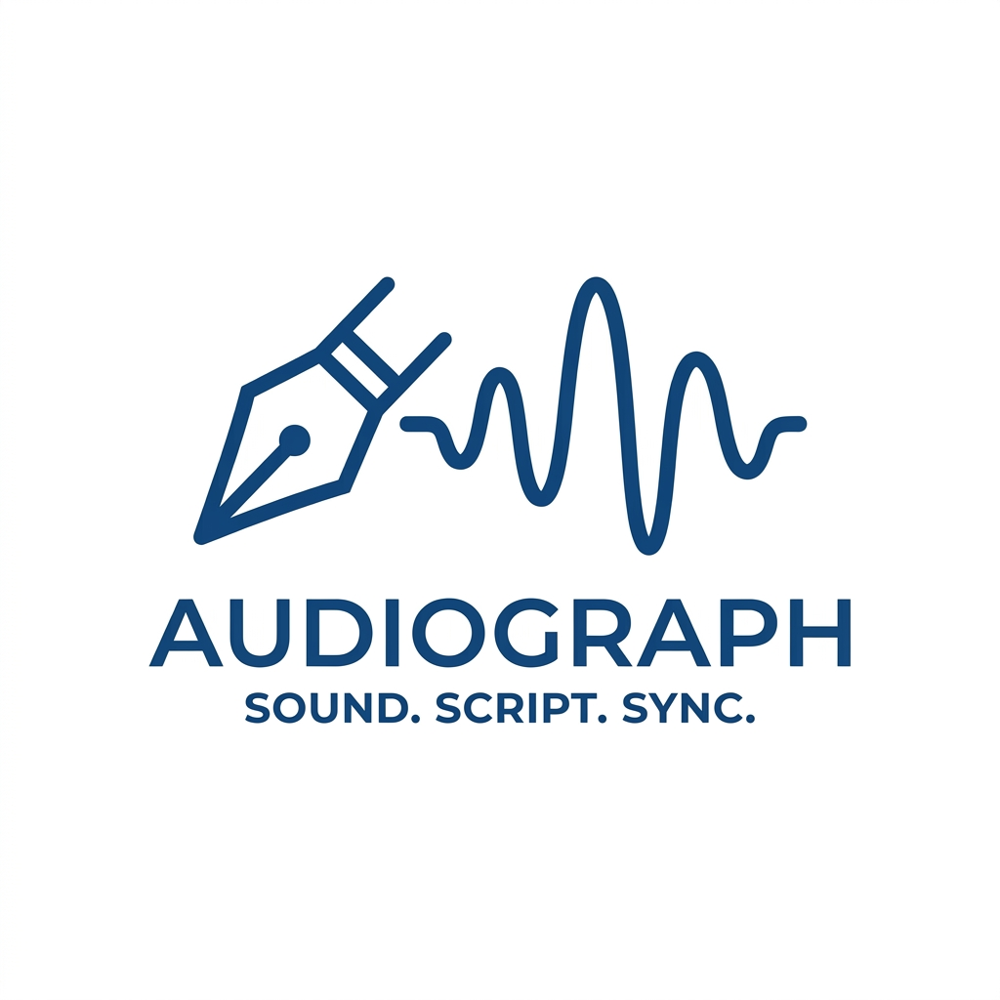
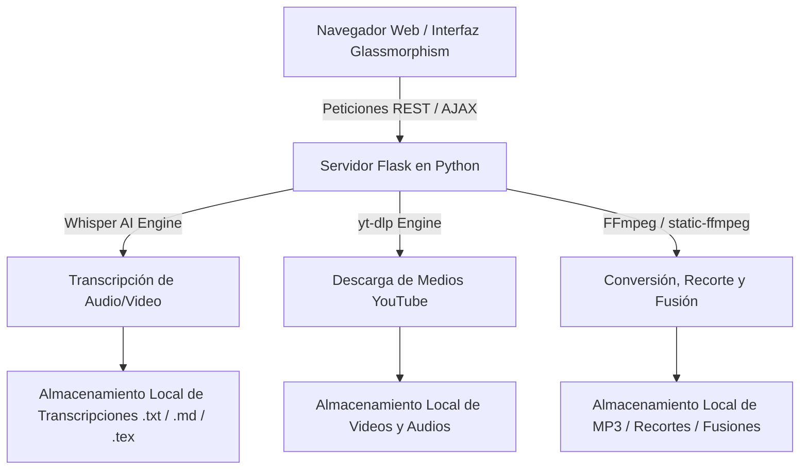

<div align="center">

  

  # AudioScribe 🎙️✨
  ### Suite Integral de Transcripción con IA, Procesamiento y Edición Multimedia

  [](https://www.python.org/)
  [](https://flask.palletsprojects.com/)
  [](https://github.com/openai/whisper)
  [](https://ffmpeg.org/)
  [](LICENSE)

  <p align="center">
    <b>AudioScribe</b> es una plataforma web moderna, autocontenida y de alto rendimiento que combina el poder de <b>OpenAI Whisper</b>, <b>yt-dlp</b> y <b>FFmpeg</b> en una elegante interfaz basada en <i>Glassmorphism</i>. Permite transcribir, convertir, descargar, recortar y fusionar contenido multimedia local o de YouTube sin depender de servicios de terceros en la nube.
  </p>

</div>

---

## 🌟 Características Principales

### 1. 🎙️ Transcriptor de Audio y Video con IA
* **Motor Whisper AI**: Soporte multilingüe para más de 90 idiomas con modelos escalables (`tiny`, `base`, `small`, `medium`, `large`).
* **Múltiples Fuentes de Entrada**: Procesa archivos locales (`.mp3`, `.wav`, `.m4a`, `.mp4`, `.mkv`, `.flac`, `.aac`, `.ogg`) o enlaces directos de **YouTube**.
* **Exportación Multiformato**: Descarga la transcripción generada en tres formatos independientes:
  * 📄 **Bloc de Notas (`.txt`)**
  * 📝 **Markdown estructurado (`.md`)**
  * 📑 **Reporte académico en LaTeX (`.tex`)**
* **Cancelación en Tiempo Real**: Botón de parada de emergencia para liberar recursos inmediatamente.

### 2. 📹 Descargador de Videos de YouTube
* Descarga directa de videos en formato **MP4** con audio integrado de alta calidad.
* **Selector de Calidad**: Máxima resolución disponible (`1080p+ / 4K`), `720p HD`, `480p` y `360p`.
* Monitoreo de velocidad, porcentaje y peso en tiempo real mediante `progress_hooks`.

### 3. 🎵 Convertidor a MP3 de Alta Fidelidad
* Extracción y codificación rápida de audio a **MP3**.
* **Selector de Tasa de Bits (*Bitrate*)**: `320 kbps` (calidad de estudio), `256 kbps`, `192 kbps` y `128 kbps`.

### 4. ✂️ Recortador de Multimedia (Audio & Video)
* Recorte preciso de segmentos mediante marcas de tiempo (`HH:MM:SS` o `MM:SS`).
* Soporte para exportar el fragmento resultante como **Video MP4** o **Audio MP3**.
* Carga inmediata al reproductor o transcriptor con un solo clic.

### 5. 🔀 Fusionador de Archivos Multimedia (Joiner / Merger)
* Concatenación fluida de múltiples pistas de audio o videos.
* Lista interactiva con capacidad para **reordenar (⬆️ Subir / ⬇️ Bajar)** y eliminar pistas antes de la renderización final.

### 6. 📋 Sistema de Cola por Lotes (*Batch Processing Queue*)
* Modo por lotes para transcribir o descargar **múltiples URLs de YouTube** o **decenas de archivos locales** de forma automática y secuencial.
* Panel visual con insignias de estado en tiempo real: `⏳ En espera`, `🔄 Procesando`, `✅ Completado`, `❌ Error`.

### 7. 🔊 Reproductor TTS, Analítica de Texto y Notificaciones Sonoras
* **Síntesis de Voz (Web Speech API)**: Escucha la transcripción con control de velocidad (`0.75x` a `2.0x`) y selección de voces instaladas en el sistema operativo.
* **Panel de Estadísticas**: Métricas en vivo de total de palabras, caracteres, velocidad de lectura estimada (PPM) y nube de palabras clave.
* **Feedback Auditivo (Web Audio API)**: Acorde sintetizado no invasivo que alerta al usuario al completarse cualquier procesamiento (conmutador `🔔/🔕` disponible).

### 8. 🗄️ Gestión de Archivos Centralizada (Matriz Bento 3x2)
* Panel con 6 tarjetas organizadas: *Transcripciones*, *Videos MP4*, *Audios de YT*, *Convertidos MP3*, *Archivos Recortados* y *Archivos Fusionados*.
* Acciones directas: Descarga local (📥), Carga al Transcriptor (🎙️), Apertura de carpeta en el explorador (📁) y Limpieza segura (🗑️).

### 9. 🌐 Acceso por Red Local (Multi-dispositivo)
* Despliegue en red con detección automática de IP local: Utiliza AudioScribe desde tu teléfono celular, tablet u otra laptop conectada a la misma red Wi-Fi.

---

## 🛠️ Tecnologías y Arquitectura



* **Backend**: Python 3.9+, Flask, Flask-CORS, Werkzeug, Threading Lock para concurrencia segura.
* **Inteligencia Artificial**: OpenAI Whisper, PyTorch.
* **Procesamiento Multimedia**: `yt-dlp`, `ffmpeg` (con carga dinámica multiplataforma y fallback `static-ffmpeg`).
* **Frontend**: HTML5 Semántico, CSS3 Moderno (Variables CSS, Flexbox/Grid, Glassmorphism, Mesh Background), JavaScript Vanilla (ES6+, Web Speech API, Web Audio API).

---

## 🚀 Requisitos e Instalación

### Prerrequisitos
* **Python 3.9 o superior** instalado. ([Descargar Python](https://www.python.org/downloads/)).
* Asegúrate de marcar la casilla **"Add Python to PATH"** durante la instalación en Windows.

---

### Opción A: Inicio en 1 Clic (Windows)
1. Clona o descarga este repositorio:
   ```bash
   git clone https://github.com/AngelTLH/AudioScribe.git
   cd AudioScribe
   ```
2. Haz doble clic sobre el archivo ejecutable:
   ```cmd
   iniciar_servidor.bat
   ```
   > *El script creará automáticamente el entorno virtual `.venv`, instalará todas las dependencias requeridas y abrirá tu navegador por defecto.*

---

### Opción B: Inicio en Linux / macOS
1. Abre tu terminal y navega al directorio del proyecto:
   ```bash
   git clone https://github.com/AngelTLH/AudioScribe.git
   cd AudioScribe
   ```
2. Otorga permisos de ejecución e inicia el script:
   ```bash
   chmod +x iniciar_servidor.sh
   ./iniciar_servidor.sh
   ```

---

### Opción C: Instalación y Ejecución Manual

1. **Crear y activar el entorno virtual**:
   * **Windows**:
     ```cmd
     python -m venv .venv
     .venv\Scripts\activate
     ```
   * **Linux / macOS**:
     ```bash
     python3 -m venv .venv
     source .venv/bin/activate
     ```

2. **Instalar dependencias**:
   ```bash
   pip install --upgrade pip
   pip install -r requirements.txt
   ```

3. **Iniciar el servidor**:
   ```bash
   python serve_dashboard.py
   ```

4. **Acceder a la aplicación**:
   * Localmente: `http://localhost:5000/transcriptor.html`
   * Desde otros dispositivos en la misma red Wi-Fi: `http://<TU_IP_LOCAL>:5000/transcriptor.html`

---

## 📂 Estructura del Proyecto

```text
Transcriptor_Audio_Mejora_GitHub/
├── Codigos/                         # Cuadernos Jupyter (.ipynb) de referencia
│   ├── Audio_Transcription_Dashboard.ipynb
│   └── WAV_YouTube_transcription.ipynb
├── Convertidos_MP3/                 # Salida de audios convertidos a MP3 (.gitkeep)
├── Descarga_Videos_YT/              # Salida de videos descargados de YouTube (.gitkeep)
├── Descarga_audio_YT/               # Salida de audios extraídos de YouTube (.gitkeep)
├── Fusionados_Archivos/             # Salida de concatenaciones multimedia (.gitkeep)
├── Pagina_Web/                      # Frontend web completo
│   └── iest-main/
│       ├── assets/
│       │   ├── css/styles.css       # Sistema de diseño, Glassmorphism y temas
│       │   ├── js/main.js           # Lógica interactiva
│       │   └── img/
│       ├── index.html               # Página de inicio / landing
│       ├── transcriptor.html        # Aplicación principal del Dashboard
│       ├── logo.png                 # Logotipo oficial
│       └── logo.ico                 # Favicon
├── Recortes_Archivos/               # Salida de fragmentos recortados (.gitkeep)
├── temp_uploads/                    # Almacenamiento temporal para procesamiento
├── Transcripciones/                 # Salida de transcripciones (.txt, .md, .tex)
├── .gitignore                       # Filtros de exclusión de Git
├── CONTRIBUTING.md                  # Guía para colaboradores
├── iniciar_servidor.bat             # Lanzador automático para Windows
├── iniciar_servidor.sh              # Lanzador automático para Linux/macOS
├── LICENSE                          # Licencia MIT
├── logo.png                         # Logotipo para documentación
├── PRODUCT.md                       # Especificaciones de producto
├── README.md                        # Documentación principal
├── requirements.txt                 # Lista de dependencias de Python
└── serve_dashboard.py               # Servidor backend Flask y API REST
```

---

## ⌨️ Atajos y Consejos de Uso

* **Modelos Whisper recomendados**:
  * `base`: Ideal para transcripciones rápidas en laptops convencionales.
  * `small` / `medium`: Recomendado para conferencias técnicas, términos científicos o audio con ruido de fondo.
* **Uso de GPU**: Si tu equipo cuenta con una tarjeta NVIDIA con CUDA instalado, PyTorch utilizará automáticamente la aceleración por hardware reduciendo drásticamente el tiempo de transcripción.

---

## 👨‍💻 Autor

Proyecto desarrollado y mantenido por **Angel Llanos Herrera**.

* 🐙 **GitHub**: [@AngelTLH](https://github.com/AngelTLH)
* 📧 **Correo de Contacto**: [angel.llanos@alumnos.ucm.cl](mailto:angel.llanos@alumnos.ucm.cl)

Si este proyecto te ha sido de utilidad para tus estudios, investigaciones o trabajo profesional, considera apoyarlo:

<div align="center">

  [](https://ko-fi.com/angelllanos)
  [](https://github.com/sponsors/AngelTLH)

</div>

---

## 📜 Licencia

Este proyecto está bajo la Licencia **MIT**. Consulta el archivo [LICENSE](LICENSE) para más detalles.
